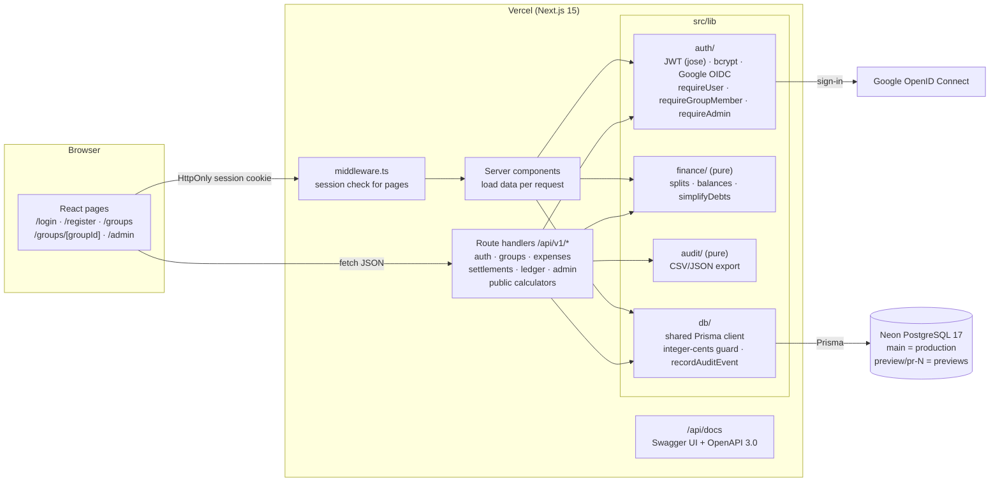
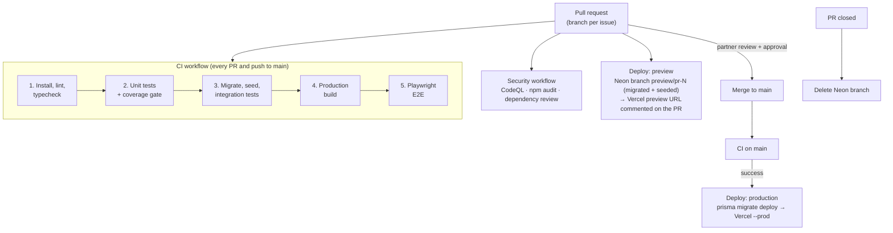

# Architecture

FairShare is one Next.js 15 application: React pages and REST route handlers in the same deployment, backed by PostgreSQL through Prisma. The money logic lives in pure TypeScript modules with no I/O, so the same code runs in the browser (live previews), in the API (server-side checks), and in the tests.

## System overview

**Request path for a change** (for example, adding an expense):

1. The add-expense dialog computes the shares with `src/lib/finance` and shows the live preview.
2. The dialog posts the expense to `POST /api/v1/groups/:groupId/expenses`.
3. `requireGroupMember(..., { write: true })` checks the session cookie, the membership (a non-member gets 404), and that the group isn't archived (409).
4. `validateExpenseInput` re-runs the same finance engines. A client's shares that don't match are refused.
5. One `prisma.$transaction` writes the expense, its splits, and an append-only `AuditEvent`.
6. The page refetches with `router.refresh()`, and the settlement board recomputes balances and transfers.

## Layers and rules

| Layer | Folder | May depend on | Notes |
| --- | --- | --- | --- |
| Pages and components | `src/app/**/page.tsx`, `src/components/` | lib, API over HTTP | Server components load data, and `'use client'` only where users interact |
| Route handlers | `src/app/api/v1/` | `lib/auth`, `lib/api`, `lib/db`, `lib/finance` | Thin: guard, then validate, then one transaction |
| Input validation | `src/lib/api/` | `lib/finance` | Pure; turns untrusted JSON into typed input or field errors |
| Authorization | `src/lib/auth/` | `lib/db` | Every private handler starts with a guard; roles are read from the database |
| Money logic | `src/lib/finance/` | nothing | Integer cents, deterministic ordinal tie-breaks, 100% test coverage enforced in CI |
| Persistence | `src/lib/db/` | Prisma | Only the shared client, which rejects non-integer amounts Prisma would silently truncate |

The detailed rules are in [AGENTS.md](../AGENTS.md); the product decisions behind them are in the [product spec](FAIRSHARE_PRODUCT_SPEC.md).

## Security model

- **Sessions:** HS256 JWT in an HttpOnly, SameSite=Lax cookie, with issuer and audience checks. Passwords use bcrypt.
- **Google sign-in:** verified server-side with `openid-client`. It never merges into an existing password account by email.
- **Authorization:** membership is checked on every group route. Non-members get the same 404 as an unknown ID, so group IDs can't be probed.
  - Admin is a platform-wide role, read from the database on every request.
  - Archived groups refuse every write with 409.
- **Input:** every body is validated at the boundary and capped at 512 KiB (413). All database access goes through Prisma, with no raw SQL in app code.
- **History:** `AuditEvent` rows are append-only, enforced by a database trigger. User references from expenses, splits, and settlements use `onDelete: Restrict`.
- **Output:** CSV exports neutralize spreadsheet formulas. `/api/docs` has a strict Content-Security-Policy, and its CDN files carry SRI hashes.
- **Pipeline:**
  - CodeQL, `npm audit` (fails on critical), and dependency review run on every PR.
  - Third-party deploy actions that receive secrets are pinned by commit.

## Delivery pipeline

See [DEPLOYMENT.md](DEPLOYMENT.md) for environments, secrets, and rollback, and the README's CI/CD section for each stage.
