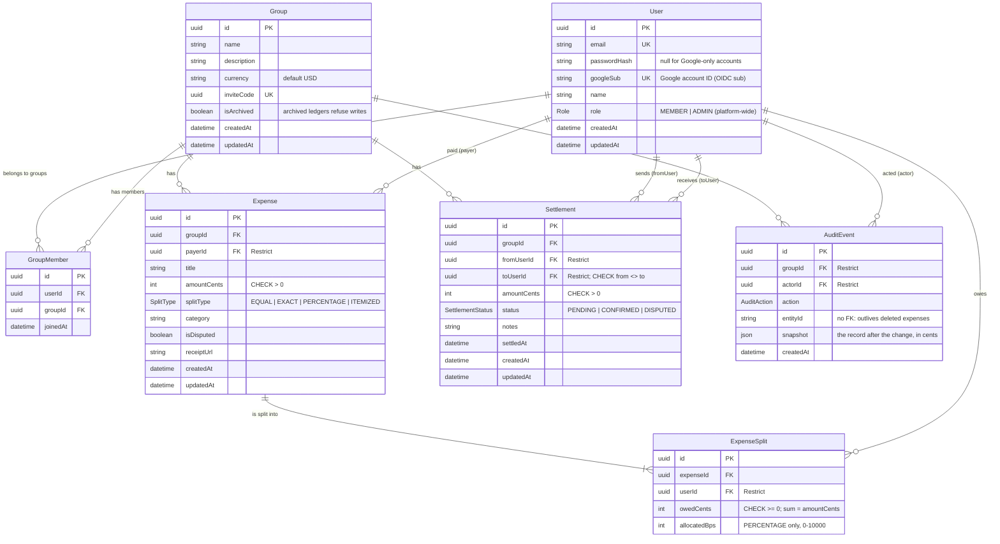

# Database schema

PostgreSQL 17, managed with Prisma migrations ([`prisma/schema.prisma`](../prisma/schema.prisma), [`prisma/migrations/`](../prisma/migrations/)). Every amount is an **integer number of cents**; percentages are **basis points** (10000 = 100%).

## Constraints and why

| Rule | Where | Why |
| --- | --- | --- |
| Amounts are `Int` cents with CHECK constraints (> 0, shares ≥ 0, basis points 0–10000, payer ≠ payee) | migration SQL | The database rejects invalid money rows even if app code is wrong |
| The shared Prisma client rejects non-integer amounts, including inside JSON snapshots | `src/lib/db/prisma.ts` | Prisma silently truncates 19.99 to 19 in an `Int` column |
| `@@unique([userId, groupId])` on members, `@@unique([expenseId, userId])` on splits | schema | One membership per person per group, and one share per person per expense |
| `onDelete: Restrict` on every user reference from expenses, splits, settlements, and audit events | schema | Deleting a user must never erase other members' balances or history |
| `AuditEvent` is append-only: a trigger rejects `UPDATE`, `DELETE`, and `TRUNCATE` | migration `add_audit_event` | Financial history can't be rewritten. Only test cleanup may delete, by turning on `fairshare.audit_maintenance` in its own transaction |
| Indexes on foreign keys and on `(groupId, createdAt)` and `(groupId, status)` | schema | PostgreSQL doesn't index foreign keys automatically; these are the page and board queries |

Each change from the blueprint's Section 5 schema, and the reason for it, is listed in the product spec's [data model decisions](FAIRSHARE_PRODUCT_SPEC.md#data-model-decisions).
